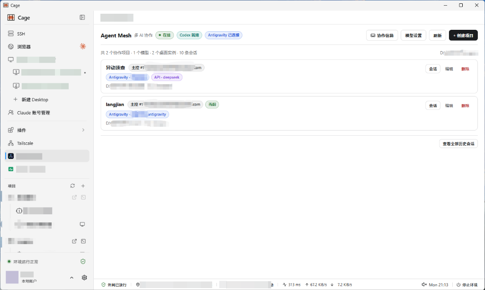
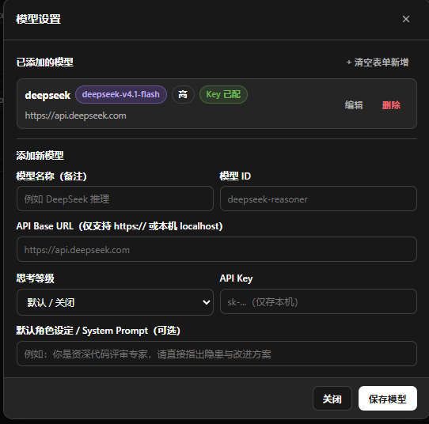
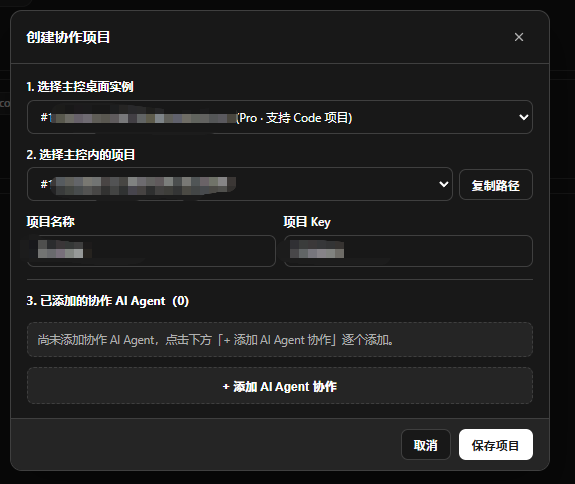
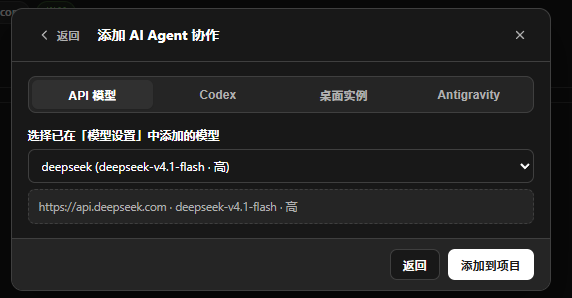
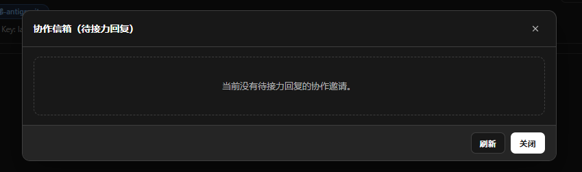

# Agent Mesh

> Multi-AI background orchestration plugin for **Claude Cage** (`>= 0.2.0`).  
> 多 AI 后台协作插件，专为 **Claude Cage** 设计：零鼠标干扰、不抢窗口焦点、零第三方 Python 依赖、支持深浅双主题与中英双语界面。

---

## 核心特性 / Features

- **开箱即用的内置引擎 / Embedded Zero-Setup Backend**  
  纯 Python 3 标准库实现，模块化架构（`mesh_core/` + `providers/` 适配器注册表），多线程并发 MCP 服务，等待回复不阻塞 UI 与接力信箱。
- **自定义推理 API 模型 / Custom OpenAI-Compatible APIs**  
  在右上角「模型设置」集中管理 DeepSeek、OpenAI、OpenRouter、Ollama 等任意兼容接口（强制仅允许 `https://` 或本机回环地址）；支持配置思考等级（`minimal` / `low` / `medium` / `high` / `xhigh`）。API Key 隔离存储于本机 `~/.agent-mesh/secrets.json`（POSIX `0600` 原子创建、Windows 当前用户 ACL 收紧）。
- **本机 Codex 桌面端 / CLI 原生协作 / Local Codex Desktop & CLI**  
  跨平台自动发现本机 Codex CLI / Codex Desktop（含 Windows / macOS Homebrew / nvm / fnm / Linux）、项目列表与模型，通过 `codex app-server --stdio`（带 `codex exec` 回退）无鼠标后台执行。**默认安全模式为 `read-only`（只读审查）**，需修改代码时可按项目显式切换为 `workspace-write`。
- **多桌面实例协作与协作信箱 / Multi-Instance Relay Inbox**  
  主界面直达「协作信箱」实时角标，支持在面板内直接查看并回复待接力任务（`mesh_check_inbox` / `mesh_reply_inbox`），也支持通过环境变量配置本地 CLI 直接执行。
- **可选 Antigravity 桌面联动 / Optional Antigravity Integration**  
  自动探测本机可选的 Antigravity Sidecar 桥接服务；无需 Antigravity 时插件依然保持在线可用。
- **分页历史、安全 Markdown 与任务取消 / Paginated History & Task Cancel**  
  支持按项目、日期（`YYYY-MM-DD`）、协作 AI、关键词分页查询（每页 10 条），采用纯 DOM 安全 Markdown 渲染回复与折叠思考过程，并支持随时中止运行中的后台任务（`mesh_cancel_conversation`）。

---

## 界面预览 / Screenshots

| 插件详情（17 工具 · 3 权限 · 无设置） | 主界面（浅色模式 · 双行卡片 · 协作信箱入口） |
| --- | --- |
|  |  |

| 模型设置（深色模式 · HTTPS / 本机校验） | 创建协作项目（深色模式） |
| --- | --- |
|  |  |

| 添加 4 路 AI 协作者（弹窗内步进视图） | 协作信箱（待接力回复 · 深色模式） |
| --- | --- |
|  |  |

---

## 目录结构 / Repository Layout

```text
agent-mesh/
├── plugins/
│   └── agent-mesh/          # 可直接提交至 Lee-xeo/cage-plugins/plugins/agent-mesh/
│       ├── plugin.json
│       ├── i18n.json
│       ├── icon.svg
│       ├── README.md
│       ├── server.py
│       ├── mesh_core/
│       │   ├── security.py
│       │   ├── storage.py
│       │   ├── discovery.py
│       │   ├── orchestrator.py
│       │   └── providers/
│       │       ├── base.py
│       │       ├── openai_compat.py
│       │       ├── codex.py
│       │       ├── claude_instance.py
│       │       └── antigravity.py
│       └── view/
│           ├── index.html
│           ├── style.css
│           └── js/
│               ├── rpc.js
│               ├── i18n.js
│               ├── markdown.js
│               ├── state.js
│               ├── providers.js
│               ├── modals.js
│               └── main.js
├── sidecar/                 # 可选：Antigravity Sidecar 桥接脚本
│   ├── bridge_sidecar.py
│   └── sidecar.json
├── scripts/
│   ├── install_local.py     # 本地一键安装（自动探测 CageData）
│   └── package_plugin.py    # 规范校验 + 打包 dist/agent-mesh-*.zip
├── LICENSE
└── README.md
```

---

## 安装方式 / Installation

### 方式 1：从插件市场安装
在 Claude Cage 左侧栏打开 **插件 → 插件市场**，搜索 **`Agent Mesh`** 点击安装即可。

### 方式 2：本地一键安装 / Local Install
```bash
python scripts/install_local.py
```
脚本会自动探测本机 Cage 数据目录（Windows / macOS / Linux），将插件安装到 `<CageData>/plugins/agent-mesh` 并执行 MCP 自检。

---

## MCP 工具列表 / MCP Tools

| Tool | Visibility | Description |
|---|---|---|
| `mesh_health` | model, app | 检查引擎状态、当前工作目录、待处理信箱数与连通性 |
| `mesh_list_projects` | model, app | 列出所有已配置的协作项目及协作者 |
| `mesh_discover_projects` | app only | 面板 UI 专用：发现本地工作区、Codex、桌面实例与 Antigravity 项目 |
| `mesh_save_project` / `mesh_bind_project` / `mesh_unbind_project` | app only | 创建、更新或删除协作项目 |
| `mesh_list_models` | model, app | 列出已保存的 API 模型（不含明文 Key） |
| `mesh_save_model` / `mesh_delete_model` | app only | 保存或删除 API 模型配置 |
| `mesh_create_conversation` | model, app | 无鼠标后台发起新协作会话（支持 `target` 与工作区内 `prompt_file`） |
| `mesh_send_message` | model, app | 向已有会话发送追问消息（支持工作区内 `message_file`） |
| `mesh_wait_reply` | model, app | 并发等待并获取最新回复（不阻塞其他请求） |
| `mesh_cancel_conversation` | model, app | 取消运行中的后台任务并终止子进程/请求 |
| `mesh_get_history` | model, app | 读取完整多轮对话及思考过程 |
| `mesh_list_conversations` | model, app | 按项目、日期、协作者、关键词分页查询历史会话 |
| `mesh_check_inbox` / `mesh_reply_inbox` | model, app | 协作信箱查收与接力回复 |

---

## License

[MIT](LICENSE)
