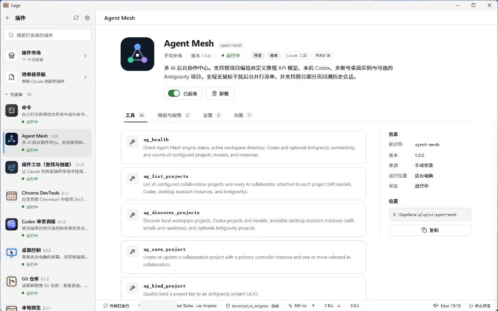
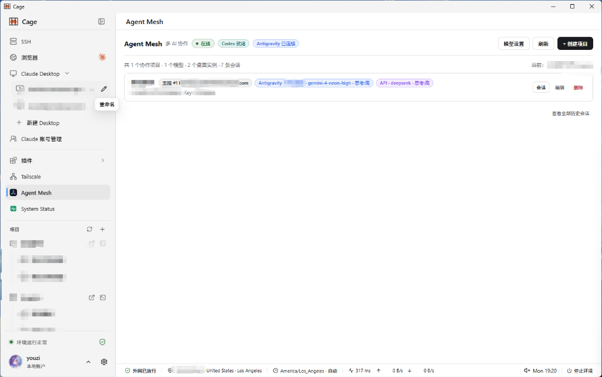
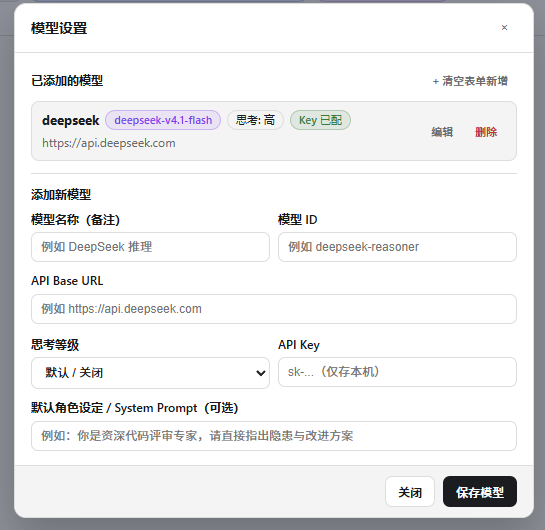
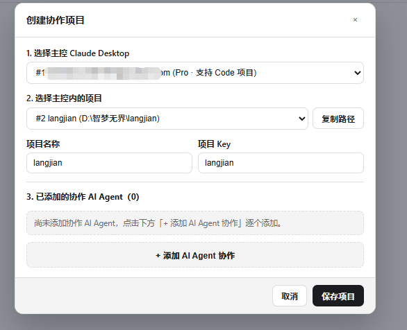
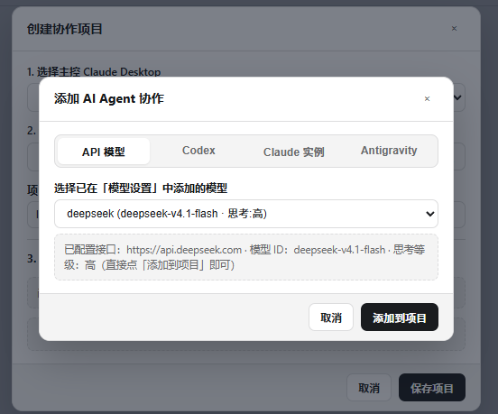

# Agent Mesh

> Multi-AI background orchestration plugin for **Claude Cage** (`>= 0.2.0`).  
> 多 AI 后台协作插件，专为 **Claude Cage** 设计：零鼠标干扰、不抢窗口焦点、零第三方 Python 依赖。

---

## 核心特性 / Features

- **开箱即用的内置引擎 / Embedded Zero-Setup Backend**  
  纯 Python 3 标准库实现，安装即在线，无需额外安装守护进程或第三方包。
- **自定义推理 API 模型 / Custom OpenAI-Compatible APIs**  
  在右上角「模型设置」集中管理 DeepSeek、OpenAI、OpenRouter、Ollama 等任意兼容接口；支持配置思考等级（`minimal` / `low` / `medium` / `high` / `xhigh`），API Key 隔离存储于本机 `~/.agent-mesh/secrets.json`。
- **本机 Codex 桌面端 / CLI 原生协作 / Local Codex Desktop & CLI**  
  自动发现本机已安装的 Codex CLI / Codex Desktop、项目列表与可用模型，通过 `codex exec` / `codex exec resume` 无鼠标后台执行并支持多轮续聊，直接复用你已在 Codex 配好的账号与代理。
- **多 Claude Desktop 实例协作 / Multi-Instance Claude Collaboration**  
  自动识别 Cage 内所有 Claude Desktop 账号与套餐状态：
  - **Pro / Max（支持 Code）**：后台全自动派单并返回结果；
  - **Free（仅对话）**：自动隐藏代码项目挂载，以协作信箱（`ag_check_inbox` / `ag_reply_inbox`）方式接力回复。
- **可选 Antigravity 桌面联动 / Optional Antigravity Integration**  
  自动探测本机可选的 Antigravity Sidecar 桥接服务；无需 Antigravity 时插件依然保持在线可用。
- **弹窗分页会话审计 / Paginated Session History**  
  支持按项目、日期（`YYYY-MM-DD`）、协作 AI、关键词筛选，每页 10 条分页浏览，点击查看完整多轮对话及折叠思考过程。

---

## 界面预览 / Screenshots

| 插件详情与 MCP 工具 | 主界面（在线 / Codex / Antigravity 状态） |
| --- | --- |
|  |  |

| 模型设置（独立管理） | 创建协作项目 | 添加 4 路 AI 协作者 |
| --- | --- | --- |
|  |  |  |

---

## 目录结构 / Repository Layout

```text
agent-mesh/
├── plugins/
│   └── agent-mesh/          # 可直接提交至 Lee-xeo/cage-plugins/plugins/agent-mesh/
│       ├── plugin.json
│       ├── i18n.json
│       ├── icon.svg
│       ├── server.py
│       ├── mesh_engine.py
│       └── view/
│           ├── index.html
│           └── app.js
├── sidecar/                 # 可选：Antigravity Sidecar 桥接脚本
│   ├── bridge_sidecar.py
│   └── sidecar.json
├── scripts/
│   ├── install_local.py     # 本地一键安装（自动探测 CageData）
│   └── package_plugin.py    # 规范校验 + 打包 dist/agent-mesh-*.zip
├── LICENSE
└── README.md
```

---

## 安装方式 / Installation

### 方式 1：从插件市场安装（待 PR 合并后）
在 Claude Cage 左侧栏打开 **插件 → 插件市场**，搜索 **`Agent Mesh`** 点击安装即可。

### 方式 2：本地一键安装 / Local Install
```bash
python scripts/install_local.py
```
脚本会自动探测本机 Cage 数据目录（Windows / macOS / Linux），将插件安装到 `<CageData>/plugins/agent-mesh` 并执行 MCP 自检。

### 方式 3：手动安装 Release 包
下载 Release 中的 `agent-mesh-1.0.0.zip`，解压至 `<CageData>/plugins/agent-mesh/`，在 Claude Cage 左侧「插件」页刷新并启用。

---

## 可选：接入 Antigravity 桌面端 / Optional Antigravity Sidecar

如仅使用 **API 模型** 与 **多 Claude 实例协作**，**跳过本节即可**。

如需同时调度本机 Antigravity 桌面端项目：
1. 将 `sidecar/sidecar.json` 复制到 `~/.gemini/config/sidecars/agent-mesh-bridge/sidecar.json`，把其中的脚本路径改为本机 `sidecar/bridge_sidecar.py` 的绝对路径；
2. 在 Antigravity 的 **Automations** 面板中手动开启该 Sidecar；
3. 回到 Claude Cage 的 **Agent Mesh** 面板点「刷新」，右上角会出现 `Antigravity 已连接` 标识。

---

## 上架到 Claude Cage 官方插件市场 / Submitting to `Lee-xeo/cage-plugins`

1. Fork [Lee-xeo/cage-plugins](https://github.com/Lee-xeo/cage-plugins)；
2. 将本仓库的 `plugins/agent-mesh/` 整个目录复制到 `cage-plugins/plugins/agent-mesh/`；
3. 在 `cage-plugins/authors.json` 中添加 `"agent-mesh": "<你的 GitHub 用户名>"`；
4. 在 `cage-plugins` 根目录执行 `python3 scripts/build.py` 生成 `dist/` 与 `index.json`；
5. 按官方 PR 模板附上运行截图并提交 Pull Request。

---

## MCP 工具列表 / MCP Tools

| Tool | Description |
|---|---|
| `ag_health` | 检查引擎状态、当前工作目录与可选 Antigravity 连通性 |
| `ag_list_projects` | 列出所有已配置的协作项目及协作者 |
| `ag_discover_projects` | 自动发现本地工作台项目、桌面实例与可选 Antigravity 项目 |
| `ag_create_conversation` | 无鼠标后台发起新协作会话（支持 `target` 指定协作者与 `prompt_file`） |
| `ag_send_message` | 向已有会话发送追问消息（支持 `message_file`） |
| `ag_wait_reply` | 等待并获取最新回复 |
| `ag_get_history` | 读取完整多轮对话及思考过程 |
| `ag_list_conversations` | 按项目、日期、协作者、关键词分页查询历史会话 |
| `ag_check_inbox` / `ag_reply_inbox` | 纯对话实例的协作信箱查收与回复 |

---

## License

[MIT](LICENSE)
